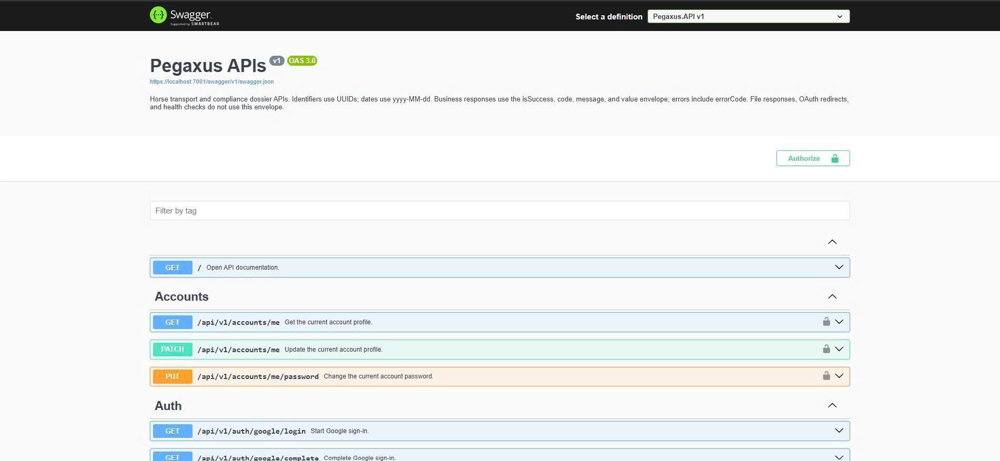
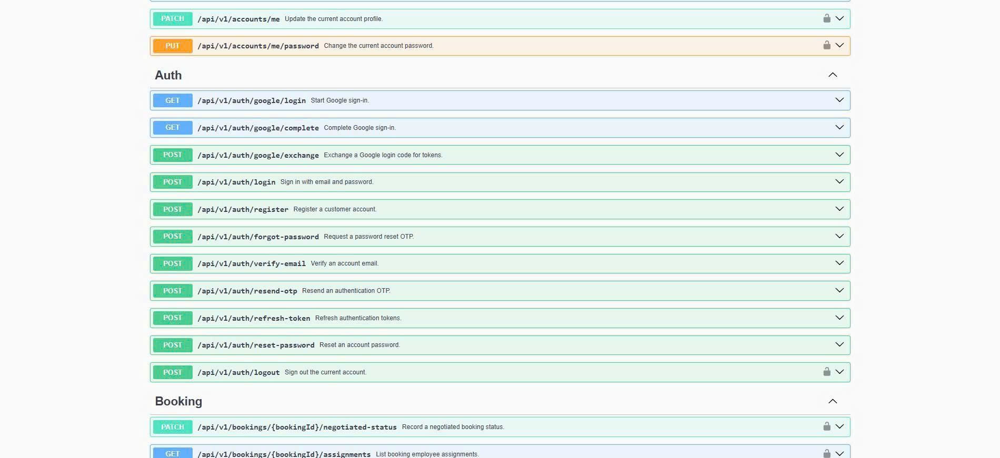
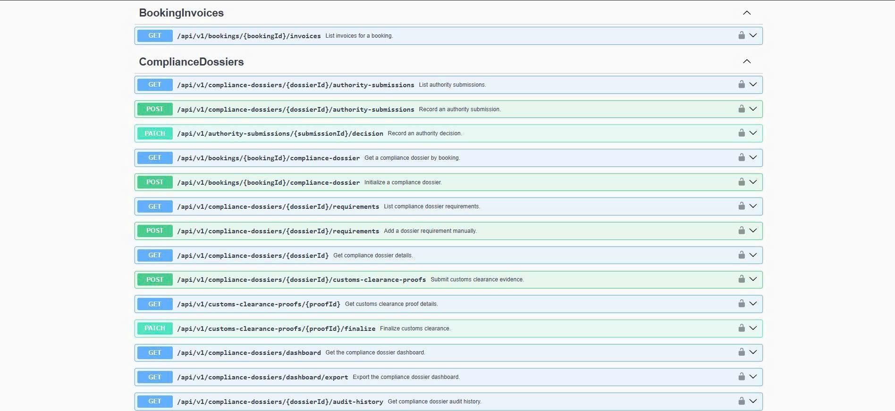
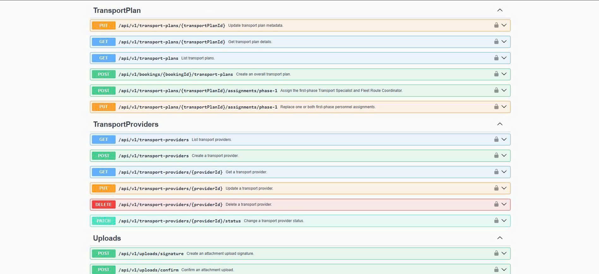
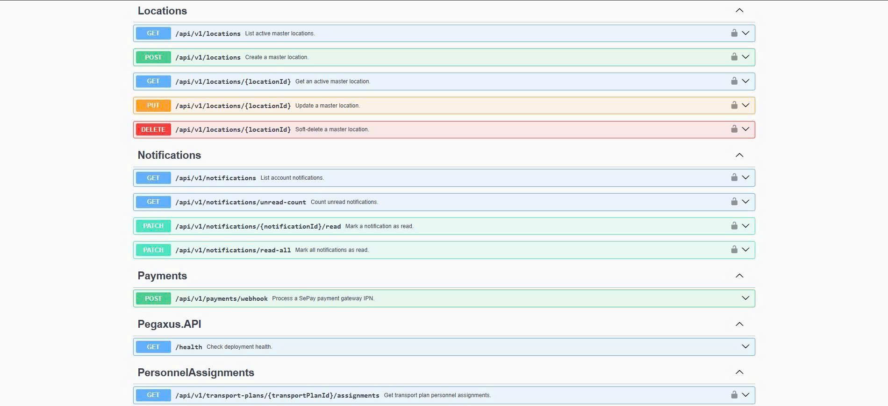
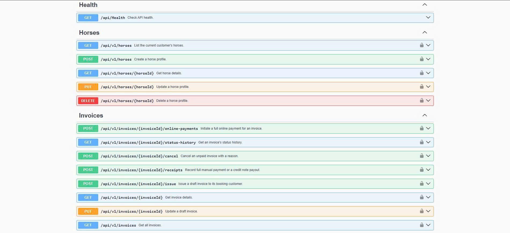

<div align="center">

# Pegaxus Backend

**Racehorse Transport & Cross-Border Compliance Management**

ASP.NET Core API for coordinating bookings, transport plans, compliance dossiers, and invoicing.

[](https://github.com/HKBDU/pegaxus-be/actions/workflows/quality.yml)
[](https://dotnet.microsoft.com/download/dotnet/8.0)
[](https://www.postgresql.org/)
[](LICENSE)

[Overview](#overview) · [Screenshots](#api-screenshots) · [Architecture](#architecture) · [Getting started](#getting-started) · [Configuration](#configuration) · [Verification](#verification)

</div>

---

## Overview

Pegaxus supports the operational workflow of domestic and cross-border racehorse transport. It brings customer bookings, transport coordination, veterinary documentation, and billing into a role-based API.

| Area | Capabilities |
| :--- | :--- |
| Accounts and access | Customer registration, email verification, password recovery, Google sign-in, and role-based authorization |
| Bookings and horses | Horse profiles, booking management, negotiated status, and booking assignments |
| Transport operations | Transport plans, routes, personnel assignments, vehicles, and external transport providers |
| Compliance | Dossier initialization, requirement checklists, document versions, reviews, authority submissions, and audit history |
| Billing and payments | Booking invoices, invoice status history, receipts, and SePay checkout |
| Notifications | Account notifications, SignalR updates, and missing-document reminders |

## API screenshots

The following Swagger captures appear in their original numbered order, from `01` through `06`. Each image shows a different part of the API.

### 01 — API overview and accounts

API description, authorization controls, and account profile endpoints.



### 02 — Authentication and bookings

Google sign-in, email and password authentication, account verification, token refresh, and booking endpoints.



### 03 — Compliance dossiers

Booking invoices, dossier initialization, requirements, authority submissions, customs clearance, and audit history.



### 04 — Transport plans and providers

Transport plan details, personnel assignments, provider management, and attachment upload endpoints.



### 05 — Locations and notifications

Master locations, account notifications, the SePay webhook, deployment health, and personnel assignments.



### 06 — Horses and invoices

Horse profile management, online payments, invoice status history, receipts, and invoice lifecycle endpoints.



## Architecture

The solution uses three application layers and a dedicated test project.

```text
pegaxus-be/
├── Pegaxus.API/           Controllers, authorization, middleware, hubs, and workers
├── Pegaxus.Service/       Business rules, use cases, DTOs, and validators
├── Pegaxus.Repository/    EF Core context, entities, mappings, and migrations
├── Pegaxus.Service.Test/  Service, HTTP contract, and PostgreSQL tests
├── Pegaxus.Dbdiagram/     Database diagrams and data dictionary
├── screenshots/          Swagger API captures
├── .github/workflows/    Repository conventions, build, and test automation
├── Directory.Build.props Shared .NET build settings
├── docker-compose.yml    API, PostgreSQL, and Redis services
├── Dockerfile            API container build
└── Pegaxus.sln            Solution entry point
```

The API calls services; services use `AppDbContext` directly. Business logic stays in the service layer. Database mappings and migrations stay in the repository project.

See [Coding conventions](CODING_CONVENTIONS.md) for module structure, transaction rules, API contracts, and test patterns.

## Technology stack

| Component | Technology |
| :--- | :--- |
| Runtime | .NET 8 and C# 12 |
| HTTP API | ASP.NET Core Web API |
| Persistence | Entity Framework Core 8, Npgsql, and PostgreSQL 16 |
| Cache | Redis 7 |
| Authentication | JWT Bearer and Google OAuth |
| Validation | FluentValidation |
| Real-time updates | ASP.NET Core SignalR |
| API documentation | Swagger / OpenAPI with Swashbuckle |
| Integrations | Cloudinary, Amazon S3, Brevo, Geoapify, and SePay |
| Delivery and testing | Docker Compose, GitHub Actions, and xUnit |

## Getting started

### Prerequisites

- [Docker Desktop](https://www.docker.com/products/docker-desktop/) with Docker Compose.
- [.NET 8 SDK](https://dotnet.microsoft.com/download/dotnet/8.0) when running or testing the API outside Docker.

### Run with Docker Compose

Clone the repository and create the local configuration file:

```powershell
git clone https://github.com/HKBDU/pegaxus-be.git
cd pegaxus-be
Copy-Item .env.example .env
```

On Linux or macOS, use `cp .env.example .env` for the last command.

Review the template values. Set `JWT_SECRET` to a private key of at least 32 characters, then configure the credentials needed by the integrations you intend to use.

Start the API, PostgreSQL, and Redis:

```bash
docker compose up --build -d
```

| Resource | Default address |
| :--- | :--- |
| Swagger UI | [http://localhost:5000/swagger](http://localhost:5000/swagger) |
| OpenAPI JSON | [http://localhost:5000/swagger/v1/swagger.json](http://localhost:5000/swagger/v1/swagger.json) |
| Application health | [http://localhost:5000/health](http://localhost:5000/health) |
| PostgreSQL | `localhost:5432` |
| Redis | `localhost:6379` |

Follow API logs with `docker compose logs -f api`. Stop the services with `docker compose down`.

### Run the API locally

Start the supporting services:

```bash
docker compose up -d postgres redis
```

In the root `.env`, set `ConnectionStrings__DefaultConnection` to a PostgreSQL connection string using `localhost`, the published database port, and credentials matching `POSTGRES_*`. Set `JwtOptions__SecretKey` for local JWT signing; `JWT_SECRET` is mapped by Docker Compose only. If Redis uses a different host port, also set `ConnectionStrings__Redis`.

```bash
dotnet restore Pegaxus.sln
dotnet run --project Pegaxus.API --launch-profile http
```

The HTTP launch profile serves Swagger at [http://localhost:5001/swagger](http://localhost:5001/swagger). The `https` profile also serves [https://localhost:7001/swagger](https://localhost:7001/swagger).

Startup applies EF Core migrations and seeds initial data. The application loads the nearest `.env` found by searching the working directory and its parents.

## Configuration

[.env.example](.env.example) lists the configuration template. ASP.NET Core settings use double underscores for nested keys.

| Settings | Purpose |
| :--- | :--- |
| `POSTGRES_USER`, `POSTGRES_PASSWORD`, `POSTGRES_DB`, `POSTGRES_PORT` | Docker PostgreSQL credentials, database, and published port |
| `API_PORT`, `REDIS_PORT` | Published Docker ports; defaults are `5000` and `6379` |
| `ConnectionStrings__DefaultConnection`, `ConnectionStrings__Redis` | Database and cache connections for a locally running API |
| `JWT_SECRET`, `JWT_ISSUER`, `JWT_AUDIENCE` | Docker Compose mappings for JWT settings |
| `JwtOptions__SecretKey`, `JwtOptions__Issuer`, `JwtOptions__Audience` | Direct JWT configuration when running outside Docker |
| `ALLOWED_ORIGINS` | Allowed frontend origins, separated by commas or semicolons |
| `Google__ClientId`, `Google__ClientSecret` | Google OAuth credentials |
| `Brevo__ApiKey`, `Brevo__SenderName`, `Brevo__SenderEmail` | Transactional email |
| `CloudinaryOptions__CloudName`, `CloudinaryOptions__ApiKey`, `CloudinaryOptions__ApiSecret` | Media storage and signed uploads |
| `DocumentStorageOptions__BucketName`, `DocumentStorageOptions__Region` | S3 document storage settings |
| `Geoapify__ApiKey` | Location service credentials |
| `SePayOptions__MerchantId`, `SePayOptions__SecretKey`, `SePayOptions__Environment`, `SePayOptions__InvoiceDetailsUrlTemplate` | SePay checkout configuration |
| `SePayWebhookOptions__SecretKey` | SePay webhook authentication |

Access tokens have a fixed 15-minute lifetime in application startup configuration. `JWT_EXPIRY_MINUTES` does not override that lifetime.

Docker Compose forwards the settings declared in its `api.environment` block. Additional integration settings must be passed to the API container explicitly.

## Verification

Build and run the default test suite:

```bash
dotnet build Pegaxus.sln --configuration Release
dotnet test Pegaxus.sln --configuration Release --no-build
```

PostgreSQL tests are enabled by `PEGAXUS_TEST_CONNECTION_STRING`. Use a PostgreSQL account with permission to create the temporary databases used by the suite:

```powershell
$env:PEGAXUS_TEST_CONNECTION_STRING = "Host=localhost;Port=5432;Username=<user>;Password=<password>;Database=postgres"
dotnet test Pegaxus.sln --configuration Release --no-build
```

[Quality CI](.github/workflows/quality.yml) validates branch and PR conventions, builds the solution, and runs tests. The PostgreSQL integration job currently runs with `continue-on-error: true`.

The `/health` endpoint reports application availability; it does not verify database or external service connectivity.

## API integration notes

Business endpoints use the `/api/v1` prefix. Identifiers are UUIDs; date-only values use `yyyy-MM-dd`. Use Swagger for request schemas and authorization requirements.

The existing integration contracts and operational notes are retained below.

<details>
<summary>SePay checkout (UC-70 / IV11)</summary>

`POST /api/v1/invoices/{invoiceId}/online-payments` requires the owning Customer and no body.
Set the four `SePayOptions__*` variables in `.env.example`; use separate Sandbox and Production credentials.
`InvoiceDetailsUrlTemplate` must contain `{invoiceId}`. Production requires HTTPS; Sandbox allows HTTP for localhost.

The response adds `value.checkoutFields` to the Flow 6 contract's `receipt` and `paymentUrl`.
Create a browser form with `method="POST"`, `action=value.paymentUrl`, and hidden inputs from `checkoutFields` in their returned order.
SePay uses signed forms, so redirecting with GET does not start checkout. The secret stays on the backend.
Checkout preparation runs locally; provider errors after form submission are handled by SePay and its IPN.
The receipt stays `PENDING`; only IV12 may confirm payment. Do not confirm it from a success redirect.

SePay bank transfers require whole VND amounts. EUR/USD return `422 UNSUPPORTED_PAYMENT_CURRENCY`;
fractional VND returns `422 UNSUPPORTED_PAYMENT_AMOUNT`. Missing configuration returns `502 PAYMENT_GATEWAY_ERROR`.
Failures during preparation roll back both the new receipt and changes to older pending receipts.
This endpoint does not call SePay to create a remote session; immediate provider-outage detection from the generic contract does not apply to this form flow.

References: [SePay checkout](https://developer.sepay.vn/vi/cong-thanh-toan/sdk/nodejs),
[Sandbox](https://developer.sepay.vn/vi/cong-thanh-toan/sandbox),
[official PHP currency/amount validation](https://github.com/sepayvn/sepay-pg-php/blob/main/src/Builders/CheckoutBuilder.php).

</details>

<details>
<summary>Manual dossier requirements (D3, D6)</summary>

Both endpoints require a Bearer token and `TransportSpecialistPolicy`. IDs use the existing UUID schema, not numeric IDs.

POST `/api/v1/compliance-dossiers/{dossierId}/requirements` requires `complianceRequirementId` and `isMandatory`.
Optional fields: `horseId`, `dueDate` (ISO date), `instruction`. A null `horseId` applies to the whole trip.
An omitted `dueDate` remains null. Legacy `leadTimeDays` and `reason` are still accepted but are not required;
do not supply both `dueDate` and `leadTimeDays`. Success returns 201, a PENDING requirement, an audit entry and a Customer notification.

PATCH `/api/v1/compliance-dossiers/{dossierId}/requirements/{requirementId}/waive` accepts `waivedReason` (required, up to 2000 characters).
Success returns 200 with status WAIVED. The requirement stays in the checklist, retains `isMandatory`, and counts as fulfilled.
The trimmed reason, acting specialist, audit entry and Customer notification are saved without submitting the dossier automatically.

| HTTP | errorCode | Condition |
| :--- | :--- | :--- |
| 409 | `DR_DUPLICATE` | The dossier/catalog/horse combination already exists, including null horse IDs |
| 409 | `DOSSIER_LOCKED` | The dossier no longer allows requirement changes |
| 400 | `REQUIREMENT_INACTIVE` | The catalog requirement is missing, deleted or not ACTIVE |
| 400 | `HORSE_NOT_IN_BOOKING` | The horse does not belong to the dossier's booking |
| 400 | `WAIVE_REASON_REQUIRED` | The waiver reason is missing or blank |

</details>

<details>
<summary>Document upload (UC-21)</summary>

For each PDF/JPG/JPEG/PNG file (up to 5 MiB), call POST `/api/v1/uploads/signature` with
`entity: "attachment"`, `contentType`, and `sizeBytes`. Upload the binary directly to the returned Cloudinary URL
using every returned parameter, then call POST `/api/v1/uploads/confirm` with `publicId`.
Signatures enforce authenticated delivery and disable overwrites. Confirmation checks actual Cloudinary metadata
and returns `publicId`, `fileName`, `mimeType`, `sizeBytes`, and a signed `fileUrl` with `fileUrlExpiresAt`.

POST `/api/v1/compliance-dossiers/{dossierId}/requirements/{requirementId}/document` with a Customer Bearer token and JSON:

```json
{
  "files": [{ "publicId": "evidence/<accountId>/<assetId>" }],
  "documentNumber": "PASS-100",
  "issuingAuthority": "Passport Authority",
  "issuedDate": "2026-10-01",
  "expiryDate": "2027-10-01",
  "uploadNote": "Full color scan"
}
```

Submit 1–10 distinct asset references in the intended page order. Do not send binary files, file URLs, MIME types,
sizes, or filenames to UC21/UC22. The service reuses MediaService to reverify account ownership and existence
and resolve trusted metadata for every publicId; a previous frontend confirmation is not trusted as proof.
Actual file bytes are downloaded by the backend for format and size checks, not uploaded again by the frontend.

Only the booking owner can upload. The dossier must be IN_PREPARATION or REJECTED; the requirement must be PENDING, REQUESTED or REJECTED.
REQUESTED requirements need an OPEN MISSING_DOCUMENT request before their first upload.
UC-21 creates the first document/version only. An existing document returns 409 rather than overwriting its version history.
The first file is stored on DocumentVersion v1; additional pages are DocumentAttachments of that same version.
Success creates one ComplianceDocument, one DocumentVersion v1, an audit entry, and sets the requirement to PROVIDED.

Document number, issuing authority and issue date are required. Issue date cannot be in the future. Expiry is required when
the catalog marks validity as required or the requirement has `valid_until`; it must be strictly after departure and at least `valid_until`.

Configure `CloudinaryOptions` using `.env.example`.
New versions store stable authenticated Cloudinary URLs resolved by the backend; signed URLs are not persisted.
Each response `value.files[]` contains `readUrl` and `readUrlExpiresAt`, expiring after five minutes.
The version-history endpoint regenerates read URLs after authorization. A Cloudinary signed delivery URL without
an expiry is not used; the SDK's private-download API signs an explicit expiration.
Legacy S3 documents remain readable using the existing private-bucket configuration and AWS credential chain.

Document submissions validate file metadata, actual file signatures and the 5 MiB size limit; antivirus scanning is not performed.
Failed content validation means document submission fails without DB changes.
Already-uploaded Cloudinary assets are not deleted on failed submissions or replacement: another version may reference them.
No orphan-asset cleanup worker or storage migration is added. Legacy superseded unreviewed S3 objects are deleted only after confirmed commit.
The DB write runs in a serializable transaction and revalidates ownership, status and expiry after storage I/O.
No migration is needed: existing unique indexes protect one document per requirement and one version number per document.
The 4-second/5-MB target needs measurement with real Cloudinary and PostgreSQL; unit tests do not establish throughput.

</details>

<details>
<summary>Document replacement and version history (UC-22)</summary>

POST `/api/v1/compliance-dossiers/{dossierId}/requirements/{requirementId}/document/versions` with a Customer token and the same JSON asset-reference contract.
`files` replaces the entire current file set (1–10 ordered publicIds; the UC-21 verification and content-validation rules apply). Metadata fields and `uploadNote` are optional.
Omitted metadata retains its current value; supplied values use the same validation as the first upload.

An unreviewed PROVIDED version is updated in place: its ID and version number stay unchanged. A reviewed or rejected version creates the next number.
Reviewed versions, attachments and reviews remain immutable. Direct uploads cannot overwrite existing Cloudinary assets.
Failed or uncertain commits never delete submitted Cloudinary assets or previously committed files. Concurrent replacements return 409.

PATCH `/api/v1/compliance-dossiers/{dossierId}/requirements/{requirementId}/document/metadata` accepts a JSON object with any of
`DocumentNumber`, `IssuingAuthority`, `IssuedDate`, `ExpiryDate`. It changes document metadata only, preserving version records, files and review status.

GET `/api/v1/compliance-dossiers/{dossierId}/requirements/{requirementId}/document/versions` returns newest-first history, all file URLs and
reviews attached to their own versions. Only the booking owner, Transport Specialist or Logistics Manager can read it; URLs expire after five minutes.
Only the booking owner can submit or edit. SATISFIED requirements and dossiers sent to authorities are locked against both file and metadata edits.
Every edit records its actor and changes in the dossier audit trail. Real PostgreSQL/Cloudinary/S3 measurement is needed to verify the 2-second DB-write target.

</details>

<details>
<summary>Dossier viewing and document previews (UC-20)</summary>

All read endpoints require a Bearer token and the enum-backed `ComplianceDossierViewerPolicy` (Customer, Transport Specialist, Logistics Manager).
Customers can read only dossiers belonging to their own bookings; other employee roles receive 403.

| GET endpoint | Result |
| :--- | :--- |
| `/api/v1/bookings/{bookingId}/compliance-dossier` | Overview, or `isInitialized: false` with the initialization message |
| `/api/v1/compliance-dossiers/{dossierId}` | Overview by dossier ID |
| `/api/v1/compliance-dossiers/{dossierId}/requirements/{requirementId}` | Requirement, document, versions, attachments, review history |
| `/api/v1/compliance-dossiers/{dossierId}/requirements/{requirementId}/versions/{versionId}/preview` | Authenticated PDF/image bytes |
| `/api/v1/compliance-dossiers/{dossierId}/requirements/{requirementId}/versions/{versionId}/attachments/{attachmentId}/preview` | Authenticated attachment bytes |

Overview accepts `status` and `horseId` query filters. `tripRequirements` and `horseRequirements` contain filtered results;
`fulfilledCount`, `requirementCount` and `completionPercent` always describe the entire dossier, excluding deleted requirements.
SATISFIED and WAIVED count as fulfilled. Empty dossiers report 0%. `actions.canUpload` is Customer-only;
`actions.canReview` is Transport Specialist-only. These flags describe role permissions; mutation APIs must enforce their own lifecycle rules.

Use the returned API `previewUrl` with an Authorization header (fetch as a Blob for browser previews), not a token query parameter.
Preview validates ownership and all nested IDs. S3 documents use the configured private bucket and exact object version, with a 5 MiB limit.
Authenticated Cloudinary files use expiring private-download URLs with a 5 MiB limit. Legacy public Cloudinary files retain the 5 MB limit.
Both storage providers use only configured locations, refuse redirects and detect PDF/raster-image types
from bytes and return no-store responses. The 15-second timeout covers both headers and body.

**Storage limitation:** Legacy server-side Cloudinary upload methods use public delivery. The proxy protects API access but cannot revoke
previously known public storage URLs. Sensitive documents must be uploaded with authenticated/private delivery and existing public
assets migrated at the storage layer before claiming end-to-end file privacy. No storage migration is performed by this read-only feature.
The 1.5-second response target still requires measurement against a real PostgreSQL database.

</details>

<details>
<summary>Document approval and readiness (UC-23)</summary>

All mutation endpoints require a Bearer token, the enum-backed `TransportSpecialistPolicy`, and an active Transport Specialist account.

| POST endpoint | Result |
| :--- | :--- |
| `/api/v1/compliance-dossiers/{dossierId}/requirements/{requirementId}/versions/{versionId}/approve` | Append APPROVED review; document APPROVED; requirement SATISFIED |
| `/api/v1/compliance-dossiers/{dossierId}/requirements/{requirementId}/versions/{versionId}/reviews/{reviewId}/revoke` | Append REVOKED review; preserve original approval |
| `/api/v1/compliance-dossiers/{dossierId}/ready-for-submission` | Explicitly mark dossier READY_FOR_SUBMISSION |

Approval requires `metadataConfirmed: true`, `versionUploadedAt` and `documentUpdatedAt` copied from the requirement-detail response.
Only the latest provided version is eligible. Changed file/metadata timestamps return 409; reload the detail and repeat verification.
`reviewNote` is optional. Expiry before departure returns 409 (`EXPIRY_EXCEPTION_REQUIRED`) until a nonblank
`expiryExceptionReason` is supplied. Both notes are limited to 2000 characters.

Revocation requires the current approval ID, `status` (PROVIDED or REJECTED), and a nonblank `reason` of at most 500 characters.
Revoking a mandatory requirement clears dossier readiness; optional revocation preserves readiness. Reviews are append-only,
with reviewer ID, UTC review time, version ID, and a dossier audit record. Approval never automatically readies or submits a dossier.
Readiness requires all nondeleted mandatory requirements to be SATISFIED or WAIVED, consistent with authority-submission rules.
Submitted, pending-authority, approved, closed, or uninitialized dossiers cannot be reviewed or marked ready.

Apply migration `20261004000000_AddRevokedDocumentReviewResult` before enabling revocation:
```bash
dotnet ef database update --project Pegaxus.Repository --startup-project Pegaxus.API
```

The migration adds the native PostgreSQL REVOKED enum value; rollback deliberately refuses to remove immutable review history.
The one-second API target still requires measurement against a real PostgreSQL database.

</details>

<details>
<summary>Document rejection and re-upload requests (UC-24)</summary>

| Endpoint | Policy | Result |
| :--- | :--- | :--- |
| POST `/api/v1/compliance-dossiers/{dossierId}/requirements/{requirementId}/versions/{versionId}/reject` | TransportSpecialistPolicy | Immutable REJECTED review, OPEN REUPLOAD request, status updates, web notification and email attempt |
| POST `/api/v1/compliance-dossiers/{dossierId}/requirements/{requirementId}/document-requests/{requestId}/comments` | CustomerOrTransportSpecialistPolicy | Append comment and notify the other participant |
| GET `/api/v1/compliance-dossiers/{dossierId}/requirements/{requirementId}/document-requests/{requestId}/comments` | CustomerOrTransportSpecialistPolicy | Ordered conversation history |

All endpoints require a Bearer token and an active account. Customers may discuss only requests belonging to their own booking.
Logistics Managers can view dossier/request details but cannot reject documents or join request conversations.

Rejection requires `errorCategory` (UNCLEAR_IMAGE, EXPIRED, MISSING_STAMP, WRONG_PAGE, METADATA_MISMATCH or OTHER),
`rejectionNote` (15–2000 characters after trimming), and `revisionDeadline` (ISO date, today or later in UTC).
Copy `versionUploadedAt` and the document's `updatedAt` from the requirement-detail response into
`versionUploadedAt` and `documentUpdatedAt`. Stale snapshots or older versions return 409.
`requirementStatus` accepts REJECTED (default) or REQUESTED; `dossierStatus` accepts IN_PREPARATION (default) or REJECTED.
The latest document and requirement must both be PROVIDED. Submitted, pending-authority, approved, closed and uninitialized dossiers are blocked.
No authority submission is created automatically. Readiness and satisfaction timestamps are cleared by this explicit TS action.

Overview requirement items expose `openDocumentRequest`; requirement detail exposes `documentRequests`.
Frontend should render the exact plain-text `message` prominently, show `dueDate`, and offer its Upload New DocumentVersion action.
Upload uses the existing DocumentVersion endpoint; frontend styling is not implemented here. Comment `message` accepts 1–2000 characters;
only OPEN requests accept new comments. Existing comments and reviews remain append-only.

Review, request, audit and web notification are saved atomically before delivery. Email content is HTML-encoded.
The API exposes `emailSent` and `deliveryWarning`: SMTP failure or a two-second delivery timeout never loses the committed request.
A timeout means delivery was not confirmed; SMTP may finish afterward. No automatic email retry worker is added.
The two-second end-to-end target still requires measurement with real PostgreSQL, SMTP and realtime delivery.

Apply migration `20261003000000_AddDocumentRequestRevisions` before using these endpoints:

```bash
dotnet ef database update --project Pegaxus.Repository --startup-project Pegaxus.API
```

</details>

<details>
<summary>Missing-document reminders (UC-25)</summary>

Both endpoints require a Bearer token and the enum-backed `TransportSpecialistPolicy`; the service also requires an active TS account.

| Endpoint | Result |
| :--- | :--- |
| GET `/api/v1/compliance-dossiers/{dossierId}/missing-requirements` | Selectable missing requirements |
| POST `/api/v1/compliance-dossiers/{dossierId}/missing-document-reminders` | Update selected deadlines/statuses and send a customer reminder |

POST accepts `requirementIds` (1–100 distinct IDs belonging to this dossier), `dueDate` (ISO date),
and optional `note` (at most 2000 characters). The deadline must be today or later in UTC and no later than departure.
Only IN_PREPARATION dossiers are eligible; cancelled/rejected bookings are excluded.
Missing means a nondeleted PENDING or REQUESTED requirement with no uploaded file in any document version.
PROVIDED, SATISFIED, WAIVED and REJECTED requirements are excluded; rejected-document revision belongs to UC-24.
An invalid or already-uploaded selection rejects the entire operation, without partially changing other items.

The explicit TS action changes selected requirements to REQUESTED, sets their deadlines, creates or updates their OPEN
MISSING_DOCUMENT requests, and saves audit entries, a web notification and an email outbox record atomically.
The response contains `reminderId`, updated `requirements`, `emailSent` and any `deliveryWarning`.
The SMTP attempt has a two-second cancellation budget; failure keeps the durable email queued for retry instead of losing the reminder.

`MissingDocumentReminderWorker` runs on API startup and every minute. Automatic reminders are eligible within 21 days for
domestic trips (same normalized origin/destination country) or 60 days for cross-border trips; departed trips are excluded.
At most one automatic reminder per dossier per UTC day is persisted. A manual reminder that day or a pending unsent email
suppresses another automatic reminder. Existing requirement deadlines appear in the message; a missing deadline defaults to today.
Automatic reminders send email/web notifications but do not change requirements, deadlines or dossier submission status.

Email failures retry after five minutes, including after API restarts. Retries recheck dossier eligibility and selected missing items;
obsolete reminders are cancelled, uploaded items are omitted, and no new DocumentRequest or web notification is created for a retry.
Database uniqueness and row locks protect multi-instance scheduling/delivery. SMTP delivery is at-least-once: a process crash after
SMTP accepts email but before its database acknowledgement may produce a duplicate email. This does not duplicate the request or notification.
The under-three-second target still requires measurement with real PostgreSQL, SMTP and realtime delivery.

Apply migration `20261004100000_AddMissingDocumentReminders` before using the API/worker:

```bash
dotnet ef database update --project Pegaxus.Repository --startup-project Pegaxus.API
```

</details>

## Development reference

- [Coding conventions](CODING_CONVENTIONS.md): architecture, database access, validation, and tests.
- [Seed data reference](SEED_DATA_REFERENCE.md): initial application data.
- [Database dictionary](Pegaxus.Dbdiagram/dictionaryDB-Pegaxus/racehorse_transport_data_dictionary_v5.md): schema reference.
- [Refactor log](REFACTOR_LOG.md): structural changes and retained behavior.
- [Quality workflow](.github/workflows/quality.yml): CI checks and naming conventions.

Use branch names such as `feat/transport-planning`, `fix/invoice-status`, or `docs/readme`. PR titles follow Conventional Commits, for example `docs(readme): refresh project overview`.

## License and attribution

Developed as a capstone software engineering project for **SWP391 — Software Development Project**.

Distributed under the [Apache License 2.0](LICENSE).
